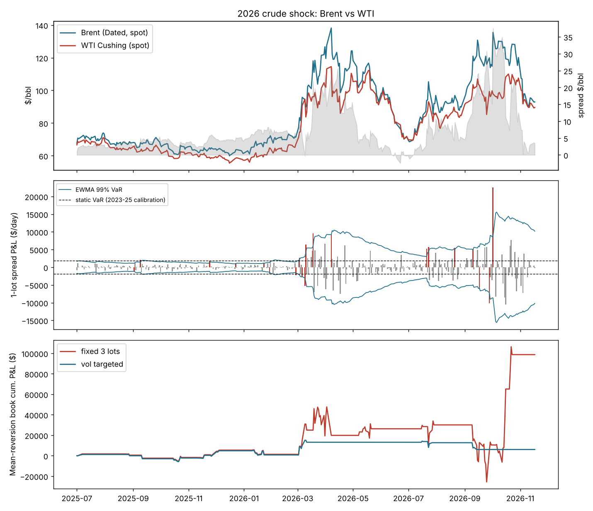

# Brent–WTI Crude Spread: Backtest, Bias Audit and 2026 Stress Test

Two questions about the same market, the gap between the two global crude oil benchmarks:
1. **Can you trade its mean reversion?** A 26-year backtest that also checks whether the backtest itself can be trusted. (`spread_backtest.py`)
2. **What happens to that trade when the market breaks?** A risk post-mortem of the 2026 Iran/Hormuz shock. (`stress_2026/crisis_risk.py`)

## Part 1: Relative-value backtest and bias audit

**Data:** EIA daily spot prices for Brent and WTI ($/bbl), from [datahub.io/core/oil-prices](https://github.com/datasets/oil-prices). Spot prices stand in for the front-month ICE Brent and NYMEX WTI futures. Both contracts are 1,000 bbl, so "1 spread" means long 1 Brent and short 1 WTI (or the reverse). P&L is in $ per spread.

### Method
1. **Is the spread mean-reverting?** ADF test on the spread, Engle–Granger cointegration test on log prices, and the Ornstein–Uhlenbeck half-life from an AR(1) fit. Each test is run by sub-period.
2. **Strategy:** compute a z-score of the spread against its rolling mean and standard deviation. Enter when |z| > entry level and exit when |z| < 0.5. Stop out at |z| > 4 or after 60 days.
3. **Costs:** $25 per spread on each entry and exit (2 legs × 1 tick slippage + fees). A sensitivity check runs from $0 to $100.
4. **Validation:** parameters (lookback 20/40/60/120 days, entry z 1.5/2/2.5) are chosen on 2000–2014 only. Results are reported on 2015 onward.
5. **Execution-timing audit:** the same strategy is run with a same-day fill, a next-day fill and a two-day fill.

### Findings
| | Same-day fill (naive) | Next-day fill (realistic) |
|---|---|---|
| Out-of-sample Sharpe (2015 onward) | **1.47** | **0.37** |
| Out-of-sample win rate | 90% | 56% |
| Out-of-sample net P&L per spread | $365k | $63k |
(Both columns use the parameters the naive backtest picked: 20-day lookback, z = 1.5.)

- **The naive edge is mostly an artifact.** Daily spread changes have a lag-1 autocorrelation of −0.33 (2000–10), −0.22 (2011–14) and −0.37 (2015–26). Brent is assessed at the London close and WTI at the New York close, so part of each day's spread move is just timing noise that reverses the next day. A same-day backtest "trades" that noise at prices you could never actually get.
- **With realistic execution there's no robust edge.** Choosing parameters under a next-day fill gives an in-sample Sharpe of 0.48 and an out-of-sample Sharpe of 0.25 (20d, z = 2.0). Out-of-sample P&L is roughly flat from 2015 to 2025 (+$6k). Most of it comes from the volatile 2026 spread (+$31k).
- **The relationship changes with the regime.** The half-life of the spread was 3.6 days in 2000–10 and 5.2 days in 2015–26. In 2011–14 it rose to 38.5 days and the spread stopped looking stationary (ADF p = 0.25, Engle–Granger p = 0.76). That was the period when landlocked WTI at Cushing traded up to about $30 below Brent. A static mean-reversion rule would have bled money for months.
- The spread's extremes were +$54 on 20 Apr 2020 (the day WTI went negative) and −$22 in Sept 2008.


## Part 2: The 2026 crude shock, a risk post-mortem

In March 2026 the Iran/Hormuz crisis pushed Dated Brent from about $71 to $138. Over the same period WTI was relatively insulated by US-specific factors: domestic supply, export-ban talk, freight costs and the risk of refinery-run cuts. The Brent–WTI spread went from a 2023–25 range of about $2–8 to $37.62 on 2 Oct 2026.

This part treats the crisis as a live stress test, asked from a spread trader's point of view:
1. How far outside the normal regime was it?
2. Would a standard risk model have warned you?
3. What happened to a mean-reversion spread book, and does volatility-targeted sizing save it?

It uses the strategy from Part 1: a 20-day lookback, entry at |z| = 2, next-day execution, with parameters chosen on 2000–14 data. **Data:** EIA daily spot prices (Dated Brent, WTI Cushing) from 2015 to 17 Nov 2026. P&L is per 1,000-bbl lot.

### Findings
**1. Regime break (calm = 2023–25, crisis = 1 Mar to 17 Nov 2026)**
| | Calm | Crisis |
|---|---|---|
| Daily s.d. of spread change, per lot | $797 | $3,726 (4.7×) |
| Brent / WTI annualised vol | 31% / 32% | 78% / 69% |
| Brent–WTI daily return correlation | 0.87 | 0.73 |
| Worst 1-day spread move, per lot | $3,080 | $22,570 (2 Oct 2026) |

There were 48 crisis days with moves beyond 4 calm-regime sigmas, against about 0.01 expected under normality. Seven days were beyond 10 sigmas, and the largest was 28 sigmas. Spread risk depends on both leg volatilities **and** their correlation, and in this crisis both went the wrong way at once.

**2. Risk model check (99% one-day VaR on 1 lot, breaches counted on both tails, 2% expected)**
| | Calm: static | Calm: EWMA | Crisis: static | Crisis: EWMA |
|---|---|---|---|---|
| Breaches | 28 | 27 | **79** | **13** |
| Expected | 14.7 | 14.7 | 3.6 | 3.6 |

A static VaR calibrated on calm data was breached on 44% of crisis days. EWMA (λ = 0.94) adapted, with its VaR rising from a $1.7k median to a $15.6k peak, but it was still breached 3.6 times as often as expected. **Even in the calm period both models fail the Kupiec test** (p < 0.01) because daily spread changes are fat-tailed. A normal-distribution VaR understates this spread's risk in every regime tested.

**3. Sizing: fixed 3 lots vs volatility-targeted (risk budget = 3 lots at calm VaR, capped at 3)**
| Crisis 2026 | Fixed 3 lots | Vol-targeted |
|---|---|---|
| Net P&L | +$97,350 | +$5,300 |
| Max drawdown | −$73,260 | −$9,070 |
| Worst day | −$27,825 | −$5,780 |
| Average lots held | 3 | 0.27 (flat 74% of days) |

Volatility targeting cut the crisis drawdown by 88%, but it also gave up nearly all of the crisis profit. On a 2015–25 basis both versions had a Sharpe ratio of about 0.1. The honest conclusion is that the fixed-size book's 2026 profit was a reward for carrying risk that no ex-ante risk budget would have allowed. It isn't evidence that the strategy has an edge.

**4. Data caveat: part of the spread wasn't tradable.** The EIA Brent series is *Dated* (physical) Brent. On 18 Mar 2026 the EIA spot spread was $21.97, while May ICE Brent minus May NYMEX WTI settled at $11.92 ([Argus](https://www.argusmedia.com/news-and-insights/latest-market-news/2803404-n-dakota-perks-up-on-widening-brent-wti-spread)). The EIA reported Dated Brent at more than $25 above front-month futures in early April ([EIA](https://www.eia.gov/TODAYinENERGY/detail.php?id=67544)). Roughly half of the spot-spread dislocation was a physical premium that a futures spread trader could not have captured, so the crisis P&L above is an upper bound.



### Context: the drivers (from contemporaneous reporting)
- Brent, as the seaborne global benchmark, absorbed the Middle East supply risk, while WTI cleared domestically ([S&P Global](https://www.spglobal.com/energy/en/news-research/latest-news/crude-oil/031926-wti-discount-to-brent-widest-since-2014-as-us-oil-remains-relatively-insulated); [Kpler](https://www.kpler.com/blog/the-wti-brent-blowout-war-risks-meet-the-export-ban-threat)).
- A threatened US crude export ban could have trapped barrels and crushed WTI (Kpler).
- From Sept to Oct, VLCC freight costs and the risk of US refinery-run cuts widened the spread from the WTI side as well ([Rigzone](https://www.rigzone.com/news/wti_discount_to_brent_deepens-30-sep-2026-184736-article/)).


## Run
```
pip install -r requirements.txt
python spread_backtest.py --brent data/brent-daily.csv --wti data/wti-daily.csv --out results
python stress_2026/crisis_risk.py --brent data/brent-daily.csv --wti data/wti-daily.csv --out stress_2026/results
```
Every number above is in `results/results.json` and `stress_2026/results/results.json`.

## Limitations and next steps
Spot prices aren't tradable futures. A proper test would use front-month futures settlement prices taken at the same time of day, with roll handling. Other next steps: a regime filter (pause trading when the rolling half-life rises), and a hedge ratio that's estimated each period instead of being fixed at 1:1.
