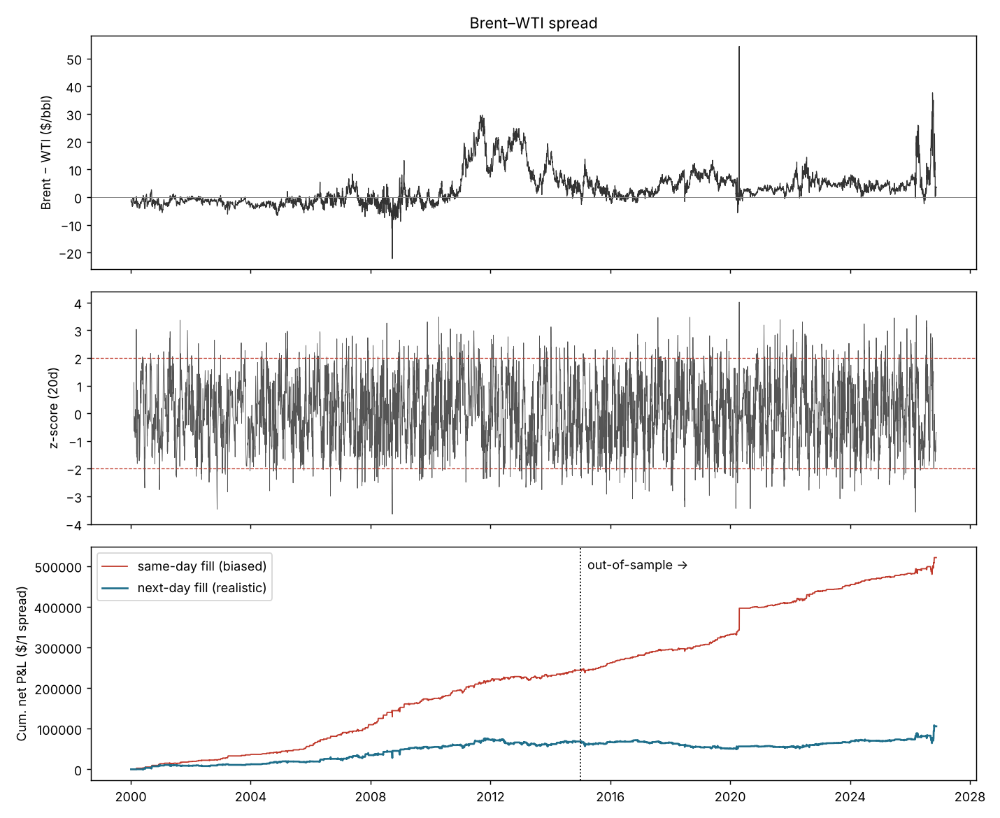

# Brent–WTI Spread: Relative-Value Backtest and Bias Audit

Can you make money trading the Brent–WTI crude spread on its mean reversion? This project tests the idea on 26 years of daily data (Jan 2000 to 17 Nov 2026, 6,070 days). It also checks whether the backtest itself can be trusted.

**Data:** EIA daily spot prices for Brent and WTI ($/bbl), from [datahub.io/core/oil-prices](https://github.com/datasets/oil-prices). Spot prices stand in for the front-month ICE Brent and NYMEX WTI futures. Both contracts are 1,000 bbl, so "1 spread" means long 1 Brent and short 1 WTI (or the reverse). P&L is in $ per spread.

## Method
1. **Is the spread mean-reverting?** ADF test on the spread, Engle–Granger cointegration test on log prices, and the Ornstein–Uhlenbeck half-life from an AR(1) fit. Each test is run by sub-period.
2. **Strategy:** compute a z-score of the spread against its rolling mean and standard deviation. Enter when |z| > entry level and exit when |z| < 0.5. Stop out at |z| > 4 or after 60 days.
3. **Costs:** $25 per spread on each entry and exit (2 legs × 1 tick slippage + fees). A sensitivity check runs from $0 to $100.
4. **Validation:** parameters (lookback 20/40/60/120 days, entry z 1.5/2/2.5) are chosen on 2000–2014 only. Results are reported on 2015 onward.
5. **Execution-timing audit:** the same strategy is run with a same-day fill, a next-day fill and a two-day fill.

## Findings
| | Same-day fill (naive) | Next-day fill (realistic) |
|---|---|---|
| Out-of-sample Sharpe (2015 onward) | **1.47** | **0.37** |
| Out-of-sample win rate | 90% | 56% |
| Out-of-sample net P&L per spread | $365k | $63k |
(Both columns use the parameters the naive backtest picked: 20-day lookback, z = 1.5.)

- **The naive edge is mostly an artifact.** Daily spread changes have a lag-1 autocorrelation of −0.33 (2000–10), −0.22 (2011–14) and −0.37 (2015–26). Brent is assessed at the London close and WTI at the New York close, so part of each day's spread move is just timing noise that reverses the next day. A same-day backtest "trades" that noise at prices you could never actually get.
- **With realistic execution there's no robust edge.** Choosing parameters under a next-day fill gives an in-sample Sharpe of 0.48 and an out-of-sample Sharpe of 0.25 (20d, z = 2.0). Out-of-sample P&L is roughly flat from 2015 to 2025 (+$6k). Most of it comes from the volatile 2026 spread (+$31k).
- **The relationship changes with the regime.** The half-life of the spread was 3.6 days in 2000–10 and 5.2 days in 2015–26. In 2011–14 it rose to 38.5 days and the spread stopped looking stationary (ADF p = 0.25, Engle–Granger p = 0.76). That was the period when landlocked WTI at Cushing traded up to about $30 below Brent. A static mean-reversion rule would have bled money for months.
- The spread's extremes were +$54 on 20 Apr 2020 (the day WTI went negative) and −$22 in Sept 2008.



## Run
```
pip install pandas numpy statsmodels matplotlib
python spread_backtest.py --brent data/brent-daily.csv --wti data/wti-daily.csv --out results
```
All numbers above are in `results/results.json`.

## Limitations and next steps
Spot prices aren't tradable futures. A proper test would use front-month futures settlement prices taken at the same time of day, with roll handling. Other next steps: a regime filter (pause trading when the rolling half-life rises), and a hedge ratio that's estimated each period instead of being fixed at 1:1.
